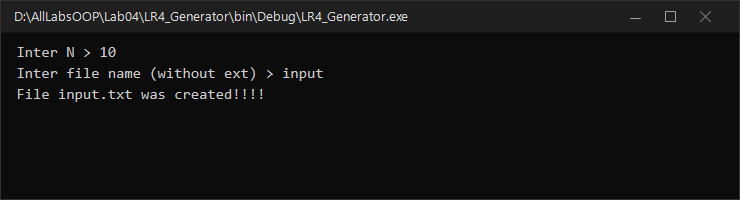
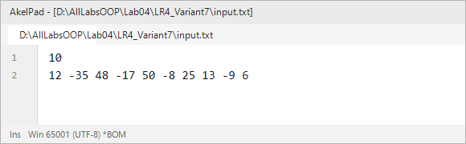
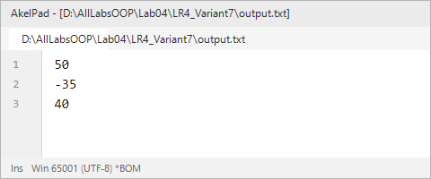

# Северо-Кавказский федеральный университет
**Институт цифрового развития**  
**Кафедра прикладной информатики**

---

### ОТЧЕТ
### по лабораторной работе №4
**по дисциплине: «Объектно-ориентированное программирование»**  
**Тема: «Одномерные массивы»**  
**Вариант №7**

**Выполнил:**  
студент группы ПИН-б-о-24-1  
Мухамеджанов Э. Т.  

Ставрополь, 2026 г.

---

## 1. Цель и задачи работы

**Цель работы:** Изучить типы и принципы работы с одномерными массивами в C#.

**Задачи работы:**
1. Научиться объявлять и инициализировать одномерные массивы.
2. Научиться создавать программы-генераторы тестовых массивов данных.
3. Научиться реализовывать алгоритмы поиска экстремумов и агрегации в массивах.
4. Освоить чтение массивов из файлов и сохранение результатов.

---

## 2. Ход выполнения работы

### 2.1. Учебная задача
В рамках учебной задачи была разработана программа-генератор случайных чисел для входных файлов и программа вычисления среднего арифметического элементов массива с последующей фильтрацией чисел, не меньших среднего.

**Результат генерации файла:**



---

### 2.2. Индивидуальное задание (Вариант 7)

#### Постановка задачи:
Во входном файле `input.txt` содержатся две строки:
1. Первая строка содержит одно целое число $N$ — количество элементов;
2. Вторая строка содержит $N$ целых чисел в диапазоне $[-10^5, 10^5]$.

В выходной файл `output.txt` необходимо вывести:
1. Максимальный четный элемент;
2. Минимальный нечетный элемент;
3. Сумму элементов, которые делятся на 5.

#### Исходный код программы (`LR4_Variant7/Program.cs`):
```csharp
using System;
using System.IO;

namespace LR4_Variant7
{
    class Program
    {
        static void Main(string[] args)
        {
            Console.OutputEncoding = System.Text.Encoding.UTF8;

            TextWriter save_out = Console.Out;
            TextReader save_in = Console.In;

            var new_out = new StreamWriter(@"output.txt");
            var new_in = new StreamReader(@"input.txt");

            Console.SetOut(new_out);
            Console.SetIn(new_in);

            int N = Convert.ToInt32(Console.ReadLine().Trim());
            string line = Console.ReadLine().Trim();
            string[] str_elem = line.Split(new char[] { ' ', '\t' }, StringSplitOptions.RemoveEmptyEntries);

            int[] mas = new int[N];
            for (int i = 0; i < N; i++)
            {
                mas[i] = Convert.ToInt32(str_elem[i]);
            }

            bool foundEven = false;
            int maxEven = int.MinValue;

            bool foundOdd = false;
            int minOdd = int.MaxValue;

            long sumDiv5 = 0;

            for (int i = 0; i < N; i++)
            {
                int val = mas[i];

                // 1. Максимальный четный
                if (val % 2 == 0)
                {
                    if (!foundEven || val > maxEven)
                    {
                        maxEven = val;
                        foundEven = true;
                    }
                }
                else // 2. Минимальный нечетный
                {
                    if (!foundOdd || val < minOdd)
                    {
                        minOdd = val;
                        foundOdd = true;
                    }
                }

                // 3. Делимость на 5
                if (val % 5 == 0)
                {
                    sumDiv5 += val;
                }
            }

            Console.WriteLine(foundEven ? maxEven.ToString() : "No");
            Console.WriteLine(foundOdd ? minOdd.ToString() : "No");
            Console.WriteLine(sumDiv5.ToString());

            Console.SetOut(save_out);
            new_out.Close();
            Console.SetIn(save_in);
            new_in.Close();
        }
    }
}
```

#### Результаты выполнения:

| Входной файл `input.txt` | Выходной файл `output.txt` |
|---|---|
|  |  |

---

## 3. Ответы на контрольные вопросы

**1. Дайте определение массива в языке C#.**  
Массив — это структура данных фиксированного размера, содержащая последовательность элементов одного типа, к которым осуществляется доступ по индексу. Все массивы в C# являются ссылочными типами и наследуются от `System.Array`.

**2. Укажите строки, в которых верно выполнено объявление массива:**  
- `int[] m;` — верно;
- `System.String[] names = { "Piro", "Nadi", "Deny" };` — верно;
- `float[,] points;` — верно (двумерный прямоугольный массив);
- `System.Int64[] big;` — верно;
- `char[] c = { 'z', 'y', 'x' };` — верно;
- `string[] str = new string[10];` — верно.  
*(Неверные строки: `int mas[];` — некорректный синтаксис C#; `float[3] points = { 1.0, 2.0, 3.0 };` — размер нельзя указывать в объявлении типа слева).*

**3. Дан фрагмент кода:**
```csharp
int[] z = new int[150];
for (int i = 0; i < z.Length; i++) {
    z[i] = i * 2;
}
int res = z[8];
```
**Какое значение содержится в переменной res после выполнения фрагмента?**  
$z[8] = 8 \cdot 2 = 16$. Значение `res`: **16**.

**4. Что будет выведено в консоль в результате работы программы?**  
Программа вычисляет и выводит сумму 150 сгенерированных псевдослучайных чисел `Random.Next()`.

**5. Поясните, как связаны величины: количество элементов в массиве, максимальное значение индексатора массива, минимальное значение индексатора массива.**  
Минимальный индекс равен 0. Максимальный индекс равен $\text{Length} - 1$. Количество элементов равно $\text{MaxIndex} + 1$.

**6. Что будет выведено в консоль в результате работы программы?**
```csharp
double[] z = { 3.0, 2.5, 10.5, 11.5, 3.01 };
for (int i = 1; i < z.Length; i++) {
    z[i]++;
}
Console.Write(z[0]);
```
Цикл начинается с индекса $i = 1$, нулевой элемент $z[0]$ не модифицируется. Будет выведено: **3** (или `3,0`).

**7. Какое значение будет выведено в результате выполнения программы?**
```csharp
float[] z = new float[5];
float s = 0;
for (int i = 0; i <= z.Length; i++) {
    s += z[i];
}
Console.Write(s);
```
Возникнет исключение **`IndexOutOfRangeException`**, так как условие `i <= z.Length` приводит к попытке обращения по индексу 5 в массиве размером 5 (допустимые индексы: 0..4).

**8. Что будет выведено в результате выполнения программы?**
```csharp
string[] имена = new string[5];
имена[0] = "Иван"; ...
Console.Write(имена);
```
Будет выведено имя типа: **`System.String[]`**, так как вызов `ToString()` для массива возвращает его полное имя типа.

**9. Что будет выведено в результате выполнения программы?**  
На последней итерации цикла ($i=4$) переменной `best_name` присваивается `имена[номера[4]] = имена[4] = "Алина"`. Будет выведено: **Алина**.

---

## 4. Вывод
В ходе работы были освоены объявление, динамическое создание и обход одномерных массивов в C#, алгоритмы поиска условных экстремумов (максимальный четный, минимальный нечетный) и вычисление сумм кратных чисел.
