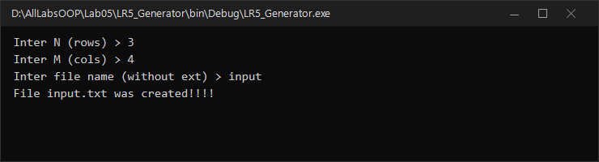
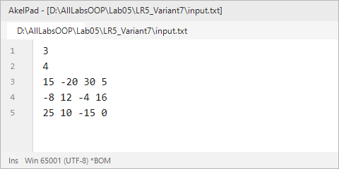
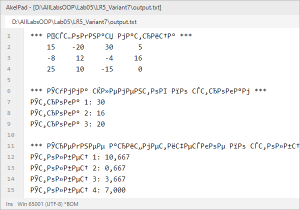

# Северо-Кавказский федеральный университет
**Институт цифрового развития**  
**Кафедра прикладной информатики**

---

### ОТЧЕТ
### по лабораторной работе №5
**по дисциплине: «Объектно-ориентированное программирование»**  
**Тема: «Многомерные массивы»**  
**Вариант №7**

**Выполнил:**  
студент группы ПИН-б-о-24-1  
Мухамеджанов Э. Т.  

Ставрополь, 2026 г.

---

## 1. Цель и задачи работы

**Цель работы:** Изучить типы и принципы работы с многомерными массивами (матрицами) в C#.

**Задачи работы:**
1. Научиться объявлять, создавать и инициализировать двумерные массивы.
2. Освоить программирование генераторов тестовых матриц в файлы.
3. Научиться реализовывать вложенные циклы для обработки строк и столбцов матриц.
4. Вычислять агрегированные показатели: суммы по строкам и средние арифметические по столбцам.

---

## 2. Ход выполнения работы

### 2.1. Учебная задача
Было разработано приложение для генерации двумерного массива целых чисел заданного размера $M \times N$ в файл и программа его обработки (нахождение максимумов каждой строки, вычисление среднего значения всей матрицы и замена элементов на `+` и `-`).

**Результат генерации тестовой матрицы:**



---

### 2.2. Индивидуальное задание (Вариант 7)

#### Постановка задачи:
Дана исходная матрица $M \times N$ целых чисел, принадлежащих отрезку $[-10^3, 10^3]$.  
В выходной файл `output.txt` необходимо вывести:
1. Исходную матрицу в табличном виде;
2. Сумму элементов по каждой строке;
3. Среднее арифметическое элементов по каждому столбцу.

#### Исходный код программы (`LR5_Variant7/Program.cs`):
```csharp
using System;
using System.IO;

namespace LR5_Variant7
{
    class Program
    {
        static void Main(string[] args)
        {
            Console.OutputEncoding = System.Text.Encoding.UTF8;

            TextWriter save_out = Console.Out;
            TextReader save_in = Console.In;

            var new_out = new StreamWriter(@"output.txt");
            var new_in = new StreamReader(@"input.txt");

            Console.SetOut(new_out);
            Console.SetIn(new_in);

            int N = Convert.ToInt32(Console.ReadLine().Trim()); // число строк
            int M = Convert.ToInt32(Console.ReadLine().Trim()); // число столбцов

            int[,] matrix = new int[N, M];

            for (int i = 0; i < N; i++)
            {
                string line = Console.ReadLine().Trim();
                string[] parts = line.Split(new char[] { ' ', '\t' }, StringSplitOptions.RemoveEmptyEntries);
                for (int j = 0; j < M; j++)
                {
                    matrix[i, j] = Convert.ToInt32(parts[j]);
                }
            }

            // 1) Вывод исходной матрицы
            Console.WriteLine("*** Исходная матрица ***");
            for (int i = 0; i < N; i++)
            {
                for (int j = 0; j < M; j++)
                {
                    Console.Write(string.Format("{0,6} ", matrix[i, j]));
                }
                Console.WriteLine();
            }
            Console.WriteLine();

            // 2) Вывод суммы элементов по каждой строке
            Console.WriteLine("*** Сумма элементов по строкам ***");
            for (int i = 0; i < N; i++)
            {
                long rowSum = 0;
                for (int j = 0; j < M; j++)
                {
                    rowSum += matrix[i, j];
                }
                Console.WriteLine(string.Format("Строка {0}: {1}", i + 1, rowSum));
            }
            Console.WriteLine();

            // 3) Среднее арифметическое элементов по каждому столбцу
            Console.WriteLine("*** Среднее арифметическое по столбцам ***");
            for (int j = 0; j < M; j++)
            {
                double colSum = 0;
                for (int i = 0; i < N; i++)
                {
                    colSum += matrix[i, j];
                }
                double colAvg = colSum / N;
                Console.WriteLine(string.Format("Столбец {0}: {1:0.000}", j + 1, colAvg));
            }

            Console.SetOut(save_out);
            new_out.Close();
            Console.SetIn(save_in);
            new_in.Close();
        }
    }
}
```

#### Результаты выполнения:

| Входной файл `input.txt` | Выходной файл `output.txt` |
|---|---|
|  |  |

---

## 3. Ответы на контрольные вопросы

**1. Приведите пример объявления массива. Приведите пример инициализации элементов массива.**  
- Объявление: `int[,] matrix;` (двумерный прямоугольный) или `double[,,] cube;` (трехмерный).  
- Инициализация: с выделением памяти `matrix = new int[3, 4];` или со списком значений:  
  `int[,] arr = { { 1, 2, 3 }, { 4, 5, 6 } };`.

**2. Что будет выведено в консоль в результате работы приложения?**
```csharp
int[,] dots = { { 0, 0, 0 }, { 1, 1, 1 }, { 2, 2, 2 } };
int zz = 10;
for (int i = 0; i < 3; i++) {
    zz *= dots[0, i];
}
Console.Write(zz);
```
Все элементы строки с индексом 0 равны 0 (`dots[0, i] == 0`). Умножение на ноль дает `zz = 0`. В консоль будет выведено: **0**.

**3. Что будет выведено в консоль в результате работы приложения?**
```csharp
int[,] dots = {
    { 10, 20, 30 },
    { 21, 17, 13 },
    { 23, 82, 82 }
};
Console.Write(dots.Length);
```
Свойство `dots.Length` возвращает суммарное количество элементов во всех измерениях массива. Для матрицы $3 \times 3$ это $3 \cdot 3 = 9$. В консоль будет выведено: **9**.

**4. Что будет выведено в консоль в результате работы приложения?**  
В цикле выполняется транспонирование матрицы: `res[i/3, i%3] = dots[i%3, i/3]`. При запросе элемента `res[1, 2]` значение читается из `dots[2, 1]`. В массиве `dots` элемент строки 2 и столбца 1 равен 80. В консоль будет выведено: **80**.

**5. Приведите фрагмент кода, демонстрирующий использование генератора случайных чисел.**
```csharp
Random rnd = new Random();
int randomInt = rnd.Next(-100, 101); // случайное целое [-100; 100]
double randomDouble = rnd.NextDouble(); // случайное вещественное [0.0; 1.0)
```

**6. В чем преимущества и недостатки непосредственного задания значений элементов массива в { } при его объявлении? В чем недостатки такого подхода?**  
- *Преимущества:* максимальная компактность и наглядность кода, отсутствие необходимости писать отдельные циклы заполнения константных данных.  
- *Недостатки:* неприменимо для динамических данных, размер массива фиксируется на этапе написания кода, при больших объемах (сотни и тысячи чисел) код становится перегруженным и нечитаемым.

**7. Как изменить размер объявленного и инициализированного массива (например, добавить дополнительные элементы)?**  
В C# размер массива фиксирован при его создании в куче. Для изменения размера необходимо создать новый массив большего размера и скопировать в него старые элементы (например, вызвав метод `Array.Resize(ref array, newSize)`), либо изначально использовать динамические коллекции (`List<T>`).

**8. Что будет выведено в консоль в результате работы приложения?**
```csharp
int[,] dots = {
    { 10, 20, 30 },
    { 40, 50, 60 },
    { 70, 80, 90 }
};
int[,] res = dots;
int A = 0;
for (int i = 0; i < 3; i++) {
    A += res[i, 2];
}
Console.WriteLine(A);
```
Суммируются элементы столбца с индексом 2 (третий столбец): $30 + 60 + 90 = 180$. В консоль будет выведено: **180**.

---

## 4. Вывод
В ходе работы были освоены многомерные прямоугольные массивы в C#, алгоритмы полинейной обработки матриц (суммы строк и средние по столбцам) и сохранение форматированных результатов в выходной файл.
