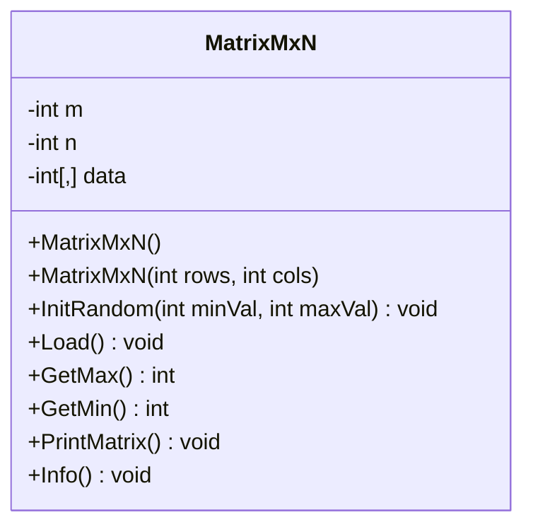
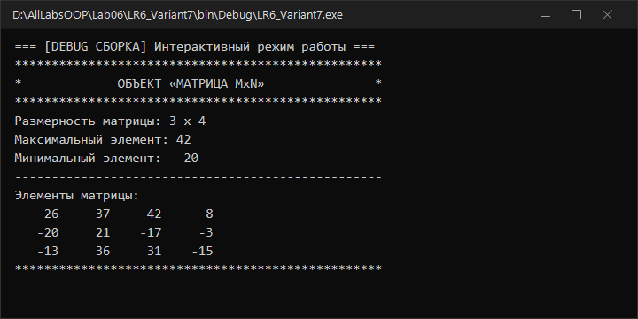
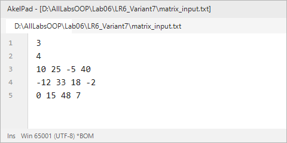
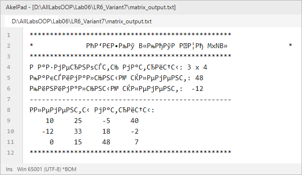

# Северо-Кавказский федеральный университет
**Институт цифрового развития**  
**Кафедра прикладной информатики**

---

### ОТЧЕТ
### по лабораторной работе №6
**по дисциплине: «Объектно-ориентированное программирование»**  
**Тема: «Классы. Объектное моделирование»**  
**Вариант №7**

**Выполнил:**  
студент группы ПИН-б-о-24-1  
Мухамеджанов Э. Т.  

Ставрополь, 2026 г.

---

## 1. Цель и задачи работы

**Цель работы:** Изучить структуру и принципы объявления классов в C#, освоить создание экземпляров классов, работу с полями и методами, а также применение директив условной компиляции.

**Задачи работы:**
1. Освоить инкапсуляцию данных через закрытые поля (`private`) и открытые методы (`public`).
2. Спроектировать класс для работы с двумерной матрицей произвольного размера $M \times N$.
3. Реализовать методы вычисления характеристик объекта (экстремумы, форматированный вывод, информация).
4. Настроить различное поведение приложения для конфигураций **Debug** (интерактивный консольный режим) и **Release** (автоматическая пакетная обработка файлов) с помощью директив `#if !DEBUG`.
5. Построить UML-диаграмму спроектированного класса.

---

## 2. Ход выполнения работы

### 2.1. UML-диаграмма класса `MatrixMxN`



---

### 2.2. Реализация класса и программы (`LR6_Variant7/Program.cs`)

```csharp
using System;
using System.IO;
using System.Text;

namespace LR6_Variant7
{
    public class MatrixMxN
    {
        private int m; // количество строк
        private int n; // количество столбцов
        private int[,] data;

        public MatrixMxN()
        {
            m = 0;
            n = 0;
            data = new int[0, 0];
        }

        public MatrixMxN(int rows, int cols)
        {
            m = rows;
            n = cols;
            data = new int[m, n];
        }

        public void InitRandom(int minVal = -50, int maxVal = 50)
        {
            Random rnd = new Random(777);
            for (int i = 0; i < m; i++)
                for (int j = 0; j < n; j++)
                    data[i, j] = rnd.Next(minVal, maxVal + 1);
        }

        public void Load()
        {
            m = Convert.ToInt32(Console.ReadLine().Trim());
            n = Convert.ToInt32(Console.ReadLine().Trim());
            data = new int[m, n];

            for (int i = 0; i < m; i++)
            {
                string line = Console.ReadLine().Trim();
                string[] parts = line.Split(new char[] { ' ', '\t' }, StringSplitOptions.RemoveEmptyEntries);
                for (int j = 0; j < n; j++)
                    data[i, j] = Convert.ToInt32(parts[j]);
            }
        }

        public int GetMax()
        {
            int max = data[0, 0];
            for (int i = 0; i < m; i++)
                for (int j = 0; j < n; j++)
                    if (data[i, j] > max)
                        max = data[i, j];
            return max;
        }

        public int GetMin()
        {
            int min = data[0, 0];
            for (int i = 0; i < m; i++)
                for (int j = 0; j < n; j++)
                    if (data[i, j] < min)
                        min = data[i, j];
            return min;
        }

        public void PrintMatrix()
        {
            for (int i = 0; i < m; i++)
            {
                for (int j = 0; j < n; j++)
                    Console.Write(string.Format("{0,6} ", data[i, j]));
                Console.WriteLine();
            }
        }

        public void Info()
        {
            Console.WriteLine("**************************************************");
            Console.WriteLine("*             ОБЪЕКТ «МАТРИЦА MxN»               *");
            Console.WriteLine("**************************************************");
            Console.WriteLine("Размерность матрицы: {0} x {1}", m, n);
            Console.WriteLine("Максимальный элемент: {0}", GetMax());
            Console.WriteLine("Минимальный элемент:  {0}", GetMin());
            Console.WriteLine("--------------------------------------------------");
            Console.WriteLine("Элементы матрицы:");
            PrintMatrix();
            Console.WriteLine("**************************************************");
        }
    }

    class Program
    {
        static void Main(string[] args)
        {
            Console.OutputEncoding = Encoding.UTF8;

#if !DEBUG
            TextWriter save_out = Console.Out;
            TextReader save_in = Console.In;
            var new_out = new StreamWriter(@"matrix_output.txt");
            var new_in = new StreamReader(@"matrix_input.txt");
            Console.SetOut(new_out);
            Console.SetIn(new_in);

            MatrixMxN matrix = new MatrixMxN();
            matrix.Load();
            matrix.Info();

            Console.SetOut(save_out);
            new_out.Close();
            Console.SetIn(save_in);
            new_in.Close();
#else
            Console.WriteLine("=== [DEBUG СБОРКА] Интерактивный режим работы ===");
            MatrixMxN matrix = new MatrixMxN(3, 4);
            matrix.InitRandom(-20, 50);
            matrix.Info();

            if (!Console.IsInputRedirected)
            {
                Console.ReadKey();
            }
#endif
        }
    }
}
```

---

### 2.3. Результаты работы в различных конфигурациях сборки

#### Режим Debug (Интерактивная консоль):


#### Режим Release (Файловый ввод-вывод):
| Входной файл `matrix_input.txt` | Выходной файл `matrix_output.txt` |
|---|---|
|  |  |

---

## 3. Ответы на контрольные вопросы

**1. Приведите определение понятия «класс».**  
Класс — это пользовательский ссылочный тип данных, выступающий в качестве шаблона для создания объектов. Он инкапсулирует внутреннее состояние (поля, свойства) и алгоритмы взаимодействия с ним (методы, события).

**2. Что такое структура? Чем структура отличается от класса?**  
Структура (`struct`) — тип по значению (Value Type), размещается в стеке и передается копированием. Класс (`class`) — ссылочный тип (Reference Type), размещается в управляемой куче (Heap), а переменная хранит ссылку на объект. Структуры не поддерживают наследование.

**3. Чем отличаются определения классов?**
`class P { int a, b, c; }` и `class P { private int a, b, c; }`  
Они идентичны по поведению, так как по умолчанию в C# уровень доступа для членов класса — `private`.

**4. Опишите ошибки компиляции во фрагменте:**
```csharp
class Person {
    private int a, b, c;
}
...
Person p = new Person();
p.a = 100;
```
Ошибка CS0122: Поле `Person.a` недоступно из-за уровня защиты `private`. Прямой доступ к закрытым полям возможен только внутри методов самого класса.

**5. Опишите ошибки компиляции во фрагменте:**
```csharp
class Person {
    public int a, b, c;
    public Person(int pA, int pB, int pC) { }
}
...
Person p = new Person();
```
Ошибка CS1729: Класс `Person` не содержит конструктора, принимающего 0 аргументов. При определении пользовательского параметризованного конструктора компилятор перестает автоматически создавать конструктор по умолчанию.

**6. Как называется переменная типа класс?**  
Переменная типа класс называется **объектом** (экземпляром класса) или **объектной ссылкой**.

**7. С использованием какого зарезервированного слова происходит объявление класса? Какое зарезервированное слово используется для объявления структуры?**  
- Класс: ключевое слово `class`.  
- Структура: ключевое слово `struct`.

**8. Опишите ошибки компиляции в классе `E1`:**
```csharp
public class E1 {
    int Z;
    public E1(int pParam) { Z = pParam; }
    float p;
    public int e;
    void Print() { Console.WriteLine(p.ToString()); }
}
```
Ошибок компиляции нет: поле `p` неявно инициализировано значением `0.0f` при создании экземпляра, а модификаторы доступа по умолчанию `private` допустимы внутри класса.

**9. Какие члены класса являются закрытыми?**
```csharp
public class E1 {
    int A;
    float B;
    public int C;
    private float D;
}
```
Закрытыми (`private`) являются поля `A`, `B` (по умолчанию) и `D` (явно объявлено `private`). Поле `C` — открытое (`public`).

**10. К каким полям нельзя обратиться из объектной переменной?**  
Из объектной переменной нельзя обратиться к закрытым (`private`) и защищенным (`protected`) полям класса.

---

## 4. Вывод
В ходе работы были освоены принципы инкапсуляции и объектного моделирования на C#. Разработан класс `MatrixMxN` с полным набором методов и реализована условная компиляция `#if !DEBUG` для разделения логики Debug и Release сборок.
