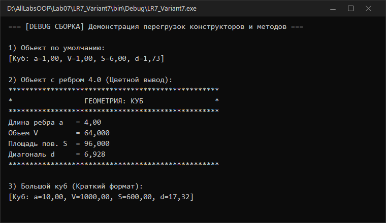
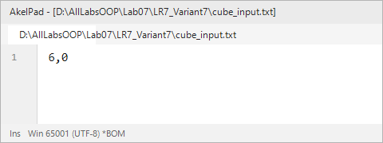
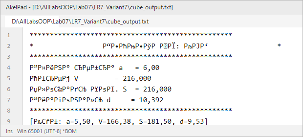

# Северо-Кавказский федеральный университет
**Институт цифрового развития**  
**Кафедра прикладной информатики**

---

### ОТЧЕТ
### по лабораторной работе №7
**по дисциплине: «Объектно-ориентированное программирование»**  
**Тема: «Конструктор класса. Перегрузка методов класса»**  
**Вариант №7**

**Выполнил:**  
студент группы ПИН-б-о-24-1  
Мухамеджанов Э. Т.  

Ставрополь, 2026 г.

---

## 1. Цель и задачи работы

**Цель работы:** Понять принципы работы конструкторов класса и механизмы перегрузки методов в C#.

**Задачи работы:**
1. Научиться объявлять перегруженные конструкторы класса с вызовом через `this`.
2. Научиться создавать перегруженные методы класса с различными сигнатурами параметров.
3. Разработать класс «Куб» (Вариант 7) с геометрическими вычислениями: объем, площадь поверхности, диагональ.
4. Реализовать цветное форматирование консольного вывода с помощью перечисления `ConsoleColor`.
5. Обеспечить двойную сборку (Debug и Release).

---

## 2. Ход выполнения работы

### 2.1. Описание класса «Куб» (Вариант 7)

Класс `Cube` описывает геометрический куб с ребром $a$:
- **Объем:** $V = a^3$;
- **Площадь поверхности:** $S = 6a^2$;
- **Пространственная диагональ:** $d = a\sqrt{3}$.

Реализованы:
- **3 перегрузки конструктора:** конструктор по умолчанию, параметризованный конструктор и фабричный метод `CreateFromFile()`;
- **3 перегрузки метода `Info()`:** стандартный вывод, вывод с настраиваемыми цветами консоли `Info(ConsoleColor fg, ConsoleColor bg)` и краткий вывод `Info(bool shortFormat)`.

---

### 2.2. Исходный код программы (`LR7_Variant7/Program.cs`)

```csharp
using System;
using System.IO;
using System.Text;

namespace LR7_Variant7
{
    public class Cube
    {
        private double a; // длина ребра куба

        // 1. Конструктор по умолчанию
        public Cube()
        {
            a = 1.0;
        }

        // 2. Параметризованный конструктор
        public Cube(double edge)
        {
            a = edge > 0 ? edge : 1.0;
        }

        // 3. Фабричный метод создания объекта из файла/потока
        public static Cube CreateFromFile()
        {
            double val = Convert.ToDouble(Console.ReadLine().Trim().Replace('.', ','));
            return new Cube(val);
        }

        public double GetV() { return Math.Pow(a, 3); }
        public double GetS() { return 6.0 * Math.Pow(a, 2); }
        public double GetDiagonal() { return a * Math.Sqrt(3.0); }

        // Перегрузка 1: Полный стандартный вывод
        public void Info()
        {
            string str =
                "**************************************************\n" +
                "*                 ГЕОМЕТРИЯ: КУБ                 *\n" +
                "**************************************************";
            Console.WriteLine(str);
            Console.WriteLine(string.Format("Длина ребра a   = {0:0.00}", a));
            Console.WriteLine(string.Format("Объем V         = {0:0.000}", GetV()));
            Console.WriteLine(string.Format("Площадь пов. S  = {0:0.000}", GetS()));
            Console.WriteLine(string.Format("Диагональ d     = {0:0.000}", GetDiagonal()));
            Console.WriteLine("**************************************************");
        }

        // Перегрузка 2: Вывод с изменением цвета фона и текста
        public void Info(ConsoleColor fg, ConsoleColor bg)
        {
            ConsoleColor prevFg = Console.ForegroundColor;
            ConsoleColor prevBg = Console.BackgroundColor;

            Console.ForegroundColor = fg;
            Console.BackgroundColor = bg;
            Info();

            Console.ForegroundColor = prevFg;
            Console.BackgroundColor = prevBg;
        }

        // Перегрузка 3: Краткий вывод
        public void Info(bool shortFormat)
        {
            if (shortFormat)
            {
                Console.WriteLine(string.Format("[Куб: a={0:0.00}, V={1:0.00}, S={2:0.00}, d={3:0.00}]",
                    a, GetV(), GetS(), GetDiagonal()));
            }
            else
            {
                Info();
            }
        }
    }

    class Program
    {
        static void Main(string[] args)
        {
            Console.OutputEncoding = Encoding.UTF8;

#if !DEBUG
            TextWriter save_out = Console.Out;
            TextReader save_in = Console.In;
            var new_out = new StreamWriter(@"cube_output.txt");
            var new_in = new StreamReader(@"cube_input.txt");
            Console.SetOut(new_out);
            Console.SetIn(new_in);

            Cube c1 = Cube.CreateFromFile();
            c1.Info();

            Cube c2 = new Cube(5.5);
            c2.Info(true);

            Console.SetOut(save_out);
            new_out.Close();
            Console.SetIn(save_in);
            new_in.Close();
#else
            Console.WriteLine("=== [DEBUG СБОРКА] Демонстрация перегрузок конструкторов и методов ===");
            
            Cube cDefault = new Cube();
            Console.WriteLine("\n1) Объект по умолчанию:");
            cDefault.Info(true);

            Cube cParam = new Cube(4.0);
            Console.WriteLine("\n2) Объект с ребром 4.0 (Цветной вывод):");
            cParam.Info(ConsoleColor.Yellow, ConsoleColor.DarkBlue);

            Cube cBig = new Cube(10.0);
            Console.WriteLine("\n3) Большой куб (Краткий формат):");
            cBig.Info(true);

            if (!Console.IsInputRedirected)
            {
                Console.ReadKey();
            }
#endif
        }
    }
}
```

---

### 2.3. Результаты выполнения

#### Режим Debug (Интерактивная консоль):


#### Режим Release (Файловый вывод):
| Входной файл `cube_input.txt` | Выходной файл `cube_output.txt` |
|---|---|
|  |  |

---

## 3. Ответы на контрольные вопросы

**1. Что такое статический класс? Что такое статический метод?**  
- *Статический класс (`static class`)* — класс с модификатором `static`, от которого нельзя создавать объекты оператором `new` и который не может содержать нестатических полей или методов.  
- *Статический метод (`static method`)* — метод, вызываемый на уровне самого типа (`Class.Method()`), а не на уровне конкретного экземпляра объекта.

**2. Что такое конструктор класса?**  
Конструктор — специальный метод класса без возвращаемого типа, имя которого строго совпадает с именем класса. Он вызывается средой исполнения CLR в момент инстанцирования объекта с помощью оператора `new` для инициализации полей объекта.

**3. Что такое перегрузка методов?**  
Перегрузка методов (Method Overloading) — объявление нескольких методов с одинаковым именем в пределах одной области видимости, отличающихся сигнатурой: количеством, типами или модификаторами принимаемых параметров.

**4. Может ли один конструктор класса вызывать другой конструктор?**  
Да, может, через ключевое слово `this(...)` в списке инициализатора: `public Cube() : this(1.0) { }`.

**5. Сколько перегрузок может иметь метод класса?**  
Количество перегрузок теоретически неограниченно, пока каждая перегрузка имеет уникальный набор типов или количества параметров.

**6. Для каких целей следует перегружать конструктор класса?**  
Для предоставления гибких возможностей создания объектов: с параметрами по умолчанию, на основе частичных данных или на основе других объектов/потоков.

**7. Что такое сигнатура метода?**  
Сигнатура метода в C# состоит из его имени, списка типов параметров и их модификаторов (`ref`, `out`). Тип возвращаемого значения в сигнатуру для перегрузки не входит.

**8. Какие ошибки присутствуют в объявлении класса Vector?**  
Конструктор с параметрами `Vector(float pX, float pY, float pZ)` не имеет модификатора `public`, то есть является `private`, поэтому его нельзя вызвать извне класса.

**9. Дано определение класса и фрагмент использования. Какие ошибки компиляции существуют в коде?**  
Поля `ПолныхЛет` и `ФИО` объявлены как `private` по умолчанию. Попытка прямого присваивания значений этим полям вне класса в методе `Main()` приводит к ошибкам компиляции CS0122 (недоступность из-за уровня защиты).

**10. Укажите ошибки в объявлении класса:**
```csharp
public static String GetName() {
    return name;
}
```
Ошибка CS0120: Статический метод `GetName()` пытается напрямую обратиться к нестатическому полю экземпляра `name`. Статический контекст не имеет ссылки `this`.

---

## 4. Вывод
В ходе работы были освоены перегрузка конструкторов и методов класса, цепочечный вызов конструкторов и применение цветовых схем `ConsoleColor` при объектном выводе.
