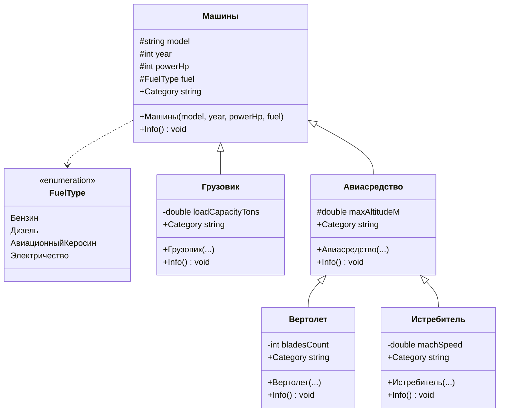
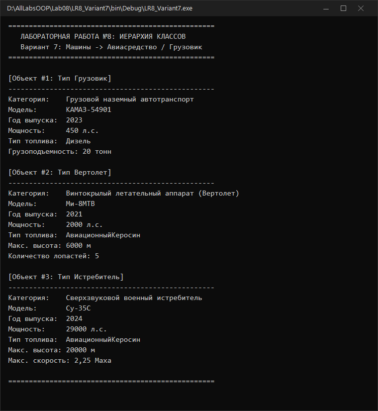

# Северо-Кавказский федеральный университет
**Институт цифрового развития**  
**Кафедра прикладной информатики**

---

### ОТЧЕТ
### по лабораторной работе №8
**по дисциплине: «Объектно-ориентированное программирование»**  
**Тема: «Проектирование иерархии классов»**  
**Вариант №7**

**Выполнил:**  
студент группы ПИН-б-о-24-1  
Мухамеджанов Э. Т.  

Ставрополь, 2026 г.

---

## 1. Цель и задачи работы

**Цель работы:** Изучить механизм организации наследования классов и полиморфизма в C#.

**Задачи работы:**
1. Научиться объявлять производные классы с использованием синтаксиса `: base`.
2. Научиться строить многоуровневые иерархии классов.
3. Освоить механизмы переопределения методов и свойств (`virtual`, `override`, `base.Method()`).
4. Применить тип-перечисление `enum` в иерархии типов.
5. Продемонстрировать полиморфную обработку разнородных объектов через массив базового типа.
6. Построить UML-диаграмму спроектированной иерархии.

---

## 2. Ход выполнения работы

### 2.1. UML-диаграмма иерархии классов (Вариант 7)



---

### 2.2. Исходный код программы (`LR8_Variant7/Program.cs`)

```csharp
using System;
using System.Text;

namespace LR8_Variant7
{
    public enum FuelType
    {
        Бензин,
        Дизель,
        АвиационныйКеросин,
        Электричество
    }

    public class Машины
    {
        protected string model;
        protected int year;
        protected int powerHp;
        protected FuelType fuel;

        public Машины(string model, int year, int powerHp, FuelType fuel)
        {
            this.model = model;
            this.year = year;
            this.powerHp = powerHp;
            this.fuel = fuel;
        }

        public virtual string Category
        {
            get { return "Общее механическое транспортное средство"; }
        }

        public virtual void Info()
        {
            Console.WriteLine("--------------------------------------------------");
            Console.WriteLine("Категория:    {0}", Category);
            Console.WriteLine("Модель:       {0}", model);
            Console.WriteLine("Год выпуска:  {0}", year);
            Console.WriteLine("Мощность:     {0} л.с.", powerHp);
            Console.WriteLine("Тип топлива:  {0}", fuel);
        }
    }

    public class Грузовик : Машины
    {
        private double loadCapacityTons;

        public Грузовик(string model, int year, int powerHp, FuelType fuel, double loadCapacityTons)
            : base(model, year, powerHp, fuel)
        {
            this.loadCapacityTons = loadCapacityTons;
        }

        public override string Category
        {
            get { return "Грузовой наземный автотранспорт"; }
        }

        public override void Info()
        {
            base.Info();
            Console.WriteLine("Грузоподъемность: {0} тонн", loadCapacityTons);
        }
    }

    public class Авиасредство : Машины
    {
        protected double maxAltitudeM;

        public Авиасредство(string model, int year, int powerHp, FuelType fuel, double maxAltitudeM)
            : base(model, year, powerHp, fuel)
        {
            this.maxAltitudeM = maxAltitudeM;
        }

        public override string Category
        {
            get { return "Авиационное транспортное средство"; }
        }

        public override void Info()
        {
            base.Info();
            Console.WriteLine("Макс. высота: {0} м", maxAltitudeM);
        }
    }

    public class Вертолет : Авиасредство
    {
        private int bladesCount;

        public Вертолет(string model, int year, int powerHp, FuelType fuel, double maxAltitudeM, int bladesCount)
            : base(model, year, powerHp, fuel, maxAltitudeM)
        {
            this.bladesCount = bladesCount;
        }

        public override string Category
        {
            get { return "Винтокрылый летательный аппарат (Вертолет)"; }
        }

        public override void Info()
        {
            base.Info();
            Console.WriteLine("Количество лопастей: {0}", bladesCount);
        }
    }

    public class Истребитель : Авиасредство
    {
        private double machSpeed;

        public Истребитель(string model, int year, int powerHp, FuelType fuel, double maxAltitudeM, double machSpeed)
            : base(model, year, powerHp, fuel, maxAltitudeM)
        {
            this.machSpeed = machSpeed;
        }

        public override string Category
        {
            get { return "Сверхзвуковой военный истребитель"; }
        }

        public override void Info()
        {
            base.Info();
            Console.WriteLine("Макс. скорость: {0} Маха", machSpeed);
        }
    }

    class Program
    {
        static void Main(string[] args)
        {
            Console.OutputEncoding = Encoding.UTF8;

            Машины[] fleet = new Машины[]
            {
                new Грузовик("КАМАЗ-54901", 2023, 450, FuelType.Дизель, 20.0),
                new Вертолет("Ми-8МТВ", 2021, 2000, FuelType.АвиационныйКеросин, 6000.0, 5),
                new Истребитель("Су-35С", 2024, 29000, FuelType.АвиационныйКеросин, 20000.0, 2.25)
            };

            for (int i = 0; i < fleet.Length; i++)
            {
                Console.WriteLine("\n[Объект #{0}: Тип {1}]", i + 1, fleet[i].GetType().Name);
                fleet[i].Info();
            }
        }
    }
}
```

---

### 2.3. Результаты выполнения



---

## 3. Ответы на контрольные вопросы

**1. Что такое наследование реализации? Как описать синтаксически наследование реализации?**  
Наследование реализации — это механизм ООП, при котором производный класс заимствует реализацию членов базового класса. Синтаксис: `class Производный : Базовый { ... }`.

**2. Для чего используется ключевое слово `base`?**  
- Для передачи аргументов в конструктор базового класса при инициализации: `: base(...)`;  
- Для вызова исходной реализации переопределенного метода или свойства: `base.Info()`.

**3. Можно ли переопределить метод класса? Свойства класса? Данные класса?**  
Методы и свойства — можно переопределять (если они объявлены как `virtual` или `abstract`). Поля данных переопределять нельзя (их можно лишь затенить с помощью `new`).

**4. Как переопределить метод в производном классе?**  
В базовом классе метод помечается модификатором `virtual` (или `abstract`), а в производном классе объявляется метод с точно такой же сигнатурой и модификатором `override`.

**5. Для чего используется ключевое слово `virtual`?**  
Для объявления методов, свойств или индексаторов, чью реализацию разрешено переопределять в классах-наследниках с помощью `override`.

**6. Для чего используется ключевое слово `override`?**  
Для создания новой реализации унаследованного виртуального или абстрактного метода или свойства.

**7. Как поменять цвет фона в консольном приложении?**  
Установить свойство `Console.BackgroundColor = ConsoleColor.ИмяЦвета;`.

**8. Укажите ошибки в фрагменте кода:**
```csharp
public class Parent { int a; }
class Child : Parent {
    int b;
    void E() { b = a; }
}
```
Ошибка CS0122: поле `Parent.a` закрыто (`private` по умолчанию) и недоступно в производном классе `Child`. Для доступа из наследников требуется уровень защиты `protected` или `public`.

**9. Сколько базовых классов может быть у любого класса в C#?**  
В C# класс может непосредственно наследоваться только от **одного** базового класса (множественное наследование классов запрещено).

**10. Даны определения классов:**
```csharp
public class Parent {
    protected int a;
    Parent() { a = 0; }
}
class Child1 : Parent {
    public Child1() : base() { }
}
```
Ошибка CS0122: конструктор базового класса `Parent()` имеет уровень доступа `private` по умолчанию. Конструктор производного класса не может обратиться к закрытому базовому конструктору. Конструктор `Parent` должен быть `public` или `protected`.

---

## 4. Вывод
В ходе работы была спроектирована двухуровневая иерархия классов транспортных средств (`Машины` $\rightarrow$ `Авиасредство` / `Грузовик` $\rightarrow$ `Вертолет` / `Истребитель`). Освоено переопределение виртуальных членов и работа с полиморфными коллекциями.
