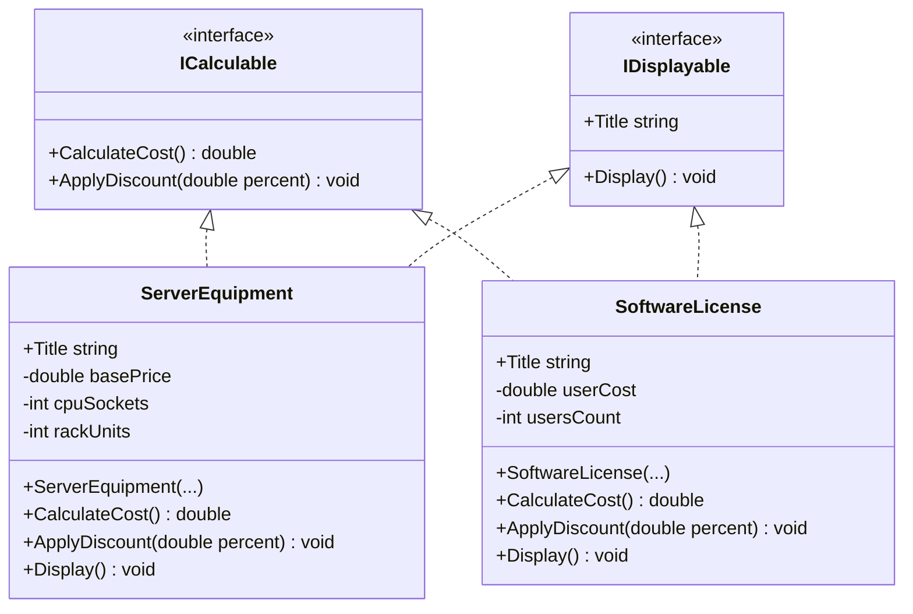
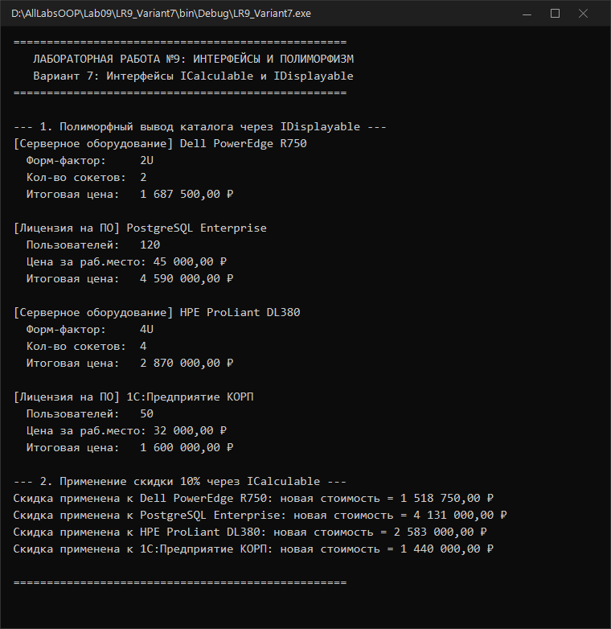

# Северо-Кавказский федеральный университет
**Институт цифрового развития**  
**Кафедра прикладной информатики**

---

### ОТЧЕТ
### по лабораторной работе №9
**по дисциплине: «Объектно-ориентированное программирование»**  
**Тема: «Полиморфизм на основе интерфейсов»**  
**Вариант №7**

**Выполнил:**  
студент группы ПИН-б-о-24-1  
Мухамеджанов Э. Т.  

Ставрополь, 2026 г.

---

## 1. Цель и задачи работы

**Цель работы:** Изучить принципы работы с типами интерфейсов в языке C# и реализацию межклассового полиморфизма.

**Задачи работы:**
1. Освоить синтаксис объявления интерфейсов в C#.
2. Научиться реализовывать интерфейсы в независимых классах.
3. Продемонстрировать полиморфную работу с разнородными объектами через интерфейсные ссылки.
4. Построить UML-диаграмму спроектированных интерфейсов и классов.

---

## 2. Ход выполнения работы

### 2.1. UML-диаграмма интерфейсов и классов (Вариант 7)



---

### 2.2. Исходный код программы (`LR9_Variant7/Program.cs`)

```csharp
using System;
using System.Text;

namespace LR9_Variant7
{
    public interface ICalculable
    {
        double CalculateCost();
        void ApplyDiscount(double percent);
    }

    public interface IDisplayable
    {
        string Title { get; set; }
        void Display();
    }

    public class ServerEquipment : ICalculable, IDisplayable
    {
        public string Title { get; set; }
        private double basePrice;
        private int cpuSockets;
        private int rackUnits;

        public ServerEquipment(string title, double basePrice, int cpuSockets, int rackUnits)
        {
            Title = title;
            this.basePrice = basePrice;
            this.cpuSockets = cpuSockets;
            this.rackUnits = rackUnits;
        }

        public double CalculateCost()
        {
            return basePrice * (1.0 + (cpuSockets - 1) * 0.35);
        }

        public void ApplyDiscount(double percent)
        {
            basePrice -= basePrice * (percent / 100.0);
        }

        public void Display()
        {
            Console.WriteLine("[Серверное оборудование] " + Title);
            Console.WriteLine("  Форм-фактор:     {0}U", rackUnits);
            Console.WriteLine("  Кол-во сокетов:  {0}", cpuSockets);
            Console.WriteLine("  Итоговая цена:   {0:C2}", CalculateCost());
        }
    }

    public class SoftwareLicense : ICalculable, IDisplayable
    {
        public string Title { get; set; }
        private double userCost;
        private int usersCount;

        public SoftwareLicense(string title, double userCost, int usersCount)
        {
            Title = title;
            this.userCost = userCost;
            this.usersCount = usersCount;
        }

        public double CalculateCost()
        {
            double total = userCost * usersCount;
            if (usersCount >= 100) total *= 0.85; // скидка 15% за объем
            return total;
        }

        public void ApplyDiscount(double percent)
        {
            userCost -= userCost * (percent / 100.0);
        }

        public void Display()
        {
            Console.WriteLine("[Лицензия на ПО] " + Title);
            Console.WriteLine("  Пользователей:   {0}", usersCount);
            Console.WriteLine("  Цена за раб.место: {0:C2}", userCost);
            Console.WriteLine("  Итоговая цена:   {0:C2}", CalculateCost());
        }
    }

    class Program
    {
        static void Main(string[] args)
        {
            Console.OutputEncoding = Encoding.UTF8;

            IDisplayable[] catalog = new IDisplayable[]
            {
                new ServerEquipment("Dell PowerEdge R750", 1250000, 2, 2),
                new SoftwareLicense("PostgreSQL Enterprise", 45000, 120),
                new ServerEquipment("HPE ProLiant DL380", 1400000, 4, 4),
                new SoftwareLicense("1С:Предприятие КОРП", 32000, 50)
            };

            Console.WriteLine("--- 1. Полиморфный вывод каталога через IDisplayable ---");
            foreach (var item in catalog)
            {
                item.Display();
                Console.WriteLine();
            }

            Console.WriteLine("--- 2. Применение скидки 10% через ICalculable ---");
            foreach (var item in catalog)
            {
                ICalculable calc = item as ICalculable;
                if (calc != null)
                {
                    calc.ApplyDiscount(10.0);
                    Console.WriteLine("Скидка применена к {0}: новая стоимость = {1:C2}", item.Title, calc.CalculateCost());
                }
            }
        }
    }
}
```

---

### 2.3. Результаты выполнения



---

## 3. Ответы на контрольные вопросы

**1. Чем отличается наследование интерфейсов от наследования реализации?**  
Наследование интерфейсов передает классу только формальную спецификацию (контракт) методов и свойств без их программного кода, обязывая класс полностью реализовать заявленные члены. Наследование реализации передает производному классу готовый код и состояние (поля) базового класса. Кроме того, класс может реализовывать произвольное количество интерфейсов, но наследоваться только от одного класса.

**2. Поясните, каким образом проявляется полиморфное поведение объектов при реализации классами интерфейсов?**  
Различные классы, не связанные иерархией наследования, могут реализовывать один и тот же интерфейс. Программа может работать с коллекцией таких разнородных объектов через единую интерфейсную ссылку (`IDisplayable`), а среда CLR во время выполнения вызовет метод соответствующего конкретного типа.

**3. Сколько интерфейсов может реализовывать класс?**  
Класс может реализовывать **любое количество** интерфейсов (ограничений в языке C# нет).

**4. Как объявляются интерфейсные типы? Для чего используются интерфейсы?**  
Объявляются с помощью ключевого слова `interface`:  
`public interface IExample { void Execute(); }`.  
Интерфейсы используются для слабого связывания (loose coupling), создания универсальных контрактов взаимодействия компонентов и реализации множественного полиморфизма.

**5. Даны определения нескольких типов. Укажите ошибки (если есть) в представленном фрагменте:**  
В фрагменте со страницы 136 методички класс `MainObject` содержит корректные публичные реализации методов `GetStr()` и `Draw()`, удовлетворяющие сигнатурам интерфейсов `IString` и `IDraw`. Ошибок компиляции в реализации класса нет.

**6. Даны определения нескольких типов. Укажите ошибки (если есть) во фрагменте:**
```csharp
Parent ob2 = new Parent();
ob2.Draw();
```
Ошибка компиляции CS1061: Класс `Parent` не реализует интерфейс `IDraw` и не содержит метода `Draw()`. Вызов `ob2.Draw()` недопустим.

---

## 4. Вывод
В ходе работы были освоены объявление и реализация интерфейсов `ICalculable` и `IDisplayable`. Продемонстрирован полиморфизм разнородных классов через интерфейсные типы и построена UML-диаграмма классов.
