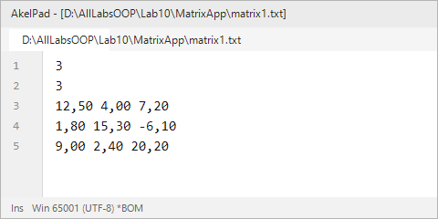
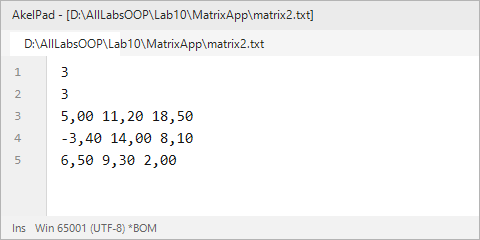
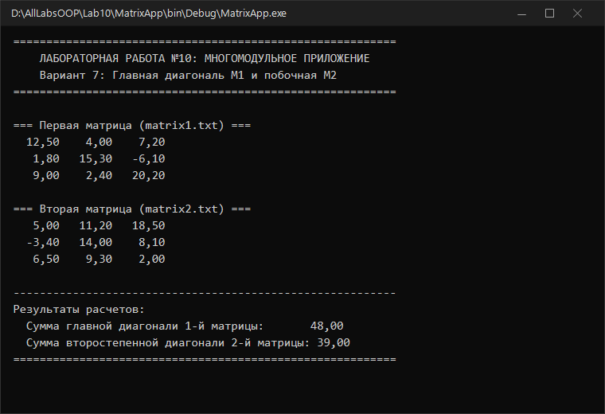

# Северо-Кавказский федеральный университет
**Институт цифрового развития**  
**Кафедра прикладной информатики**

---

### ОТЧЕТ
### по лабораторной работе №10
**по дисциплине: «Объектно-ориентированное программирование»**  
**Тема: «Основы работы с файлами. Многомодульные приложения»**  
**Вариант №7**

**Выполнил:**  
студент группы ПИН-б-о-24-1  
Мухамеджанов Э. Т.  

Ставрополь, 2026 г.

---

## 1. Цель и задачи работы

**Цель работы:** Научиться создавать многомодульные программные комплексы на C# и использовать механизмы файлового ввода-вывода потоковых классов пространства имен `System.IO`.

**Задачи работы:**
1. Разработать библиотеку классов (`Class Library`), компилируемую в виде независимой динамической библиотеки `MatrixLib.dll`.
2. Создать класс `FileMatrix` с методами загрузки, сохранения и обработки матричных данных.
3. Разработать консольное клиентское приложение `MatrixApp`, подключающее библиотеку через ссылку на сборку.
4. Реализовать расчет суммы элементов главной диагонали первой матрицы и второстепенной диагонали второй матрицы (Вариант 7).
5. Изучить работу с потоками `FileStream`, `StreamReader`, `StreamWriter` и обработку исключений `try..catch`.

---

## 2. Ход выполнения работы

### 2.1. Структура многомодульного проекта

Приложение состоит из двух независимых модулей:
1. **Библиотека `MatrixLib` (`MatrixLib.dll`):** содержит класс `FileMatrix`, предоставляющий логику работы с файлами и матричными алгоритмами;
2. **Исполняемое приложение `MatrixApp` (`MatrixApp.exe`):** загружает данные из файлов `matrix1.txt` и `matrix2.txt`, вызывает методы библиотеки и отображает расчеты.

---

### 2.2. Исходный код библиотеки классов (`MatrixLib/FileMatrix.cs`)

```csharp
using System;
using System.IO;
using System.Text;

namespace MatrixLib
{
    public class FileMatrix
    {
        private int rows;
        private int cols;
        private double[,] data;

        public int Rows { get { return rows; } }
        public int Cols { get { return cols; } }

        public FileMatrix()
        {
            rows = 0;
            cols = 0;
            data = new double[0, 0];
        }

        public FileMatrix(int r, int c)
        {
            rows = r;
            cols = c;
            data = new double[rows, cols];
        }

        public void LoadFromFile(string path)
        {
            if (!File.Exists(path))
                throw new FileNotFoundException("Файл не найден: " + path);

            using (StreamReader reader = new StreamReader(path, Encoding.UTF8))
            {
                rows = Convert.ToInt32(reader.ReadLine().Trim());
                cols = Convert.ToInt32(reader.ReadLine().Trim());
                data = new double[rows, cols];

                for (int i = 0; i < rows; i++)
                {
                    string line = reader.ReadLine().Trim();
                    string[] parts = line.Split(new char[] { ' ', '\t' }, StringSplitOptions.RemoveEmptyEntries);
                    for (int j = 0; j < cols; j++)
                    {
                        data[i, j] = Convert.ToDouble(parts[j].Replace('.', ','));
                    }
                }
            }
        }

        public double GetMainDiagonalSum()
        {
            int n = Math.Min(rows, cols);
            double sum = 0;
            for (int i = 0; i < n; i++)
                sum += data[i, i];
            return sum;
        }

        public double GetSecondaryDiagonalSum()
        {
            int n = Math.Min(rows, cols);
            double sum = 0;
            for (int i = 0; i < n; i++)
                sum += data[i, cols - 1 - i];
            return sum;
        }

        public void Print(string caption = "")
        {
            if (!string.IsNullOrEmpty(caption))
                Console.WriteLine("=== " + caption + " ===");

            for (int i = 0; i < rows; i++)
            {
                for (int j = 0; j < cols; j++)
                    Console.Write(string.Format("{0,7:0.00} ", data[i, j]));
                Console.WriteLine();
            }
        }
    }
}
```

---

### 2.3. Исходный код консольного приложения (`MatrixApp/Program.cs`)

```csharp
using System;
using System.IO;
using System.Text;
using MatrixLib;

namespace MatrixApp
{
    class Program
    {
        static void Main(string[] args)
        {
            Console.OutputEncoding = Encoding.UTF8;

            Console.WriteLine("==========================================================");
            Console.WriteLine("    ЛАБОРАТОРНАЯ РАБОТА №10: МНОГОМОДУЛЬНОЕ ПРИЛОЖЕНИЕ    ");
            Console.WriteLine("    Вариант 7: Главная диагональ M1 и побочная M2        ");
            Console.WriteLine("==========================================================\n");

            string file1 = "matrix1.txt";
            string file2 = "matrix2.txt";

            try
            {
                FileMatrix m1 = new FileMatrix();
                m1.LoadFromFile(file1);
                m1.Print("Первая матрица (" + file1 + ")");
                Console.WriteLine();

                FileMatrix m2 = new FileMatrix();
                m2.LoadFromFile(file2);
                m2.Print("Вторая матрица (" + file2 + ")");
                Console.WriteLine();

                double sumMainDiagM1 = m1.GetMainDiagonalSum();
                double sumSecDiagM2 = m2.GetSecondaryDiagonalSum();

                Console.WriteLine("----------------------------------------------------------");
                Console.WriteLine("Результаты расчетов:");
                Console.WriteLine("  Сумма главной диагонали 1-й матрицы:       {0:0.00}", sumMainDiagM1);
                Console.WriteLine("  Сумма второстепенной диагонали 2-й матрицы: {0:0.00}", sumSecDiagM2);
                Console.WriteLine("==========================================================");
            }
            catch (Exception ex)
            {
                Console.WriteLine("Ошибка: " + ex.Message);
            }
        }
    }
}
```

---

### 2.4. Результаты выполнения

| Входной файл 1 (`matrix1.txt`) | Входной файл 2 (`matrix2.txt`) |
|---|---|
|  |  |

#### Вывод работы многомодульного приложения:


---

## 3. Ответы на контрольные вопросы

**1. Какие классы для работы с файловой системой вы знаете?**  
`File`, `FileInfo`, `Directory`, `DirectoryInfo`, `Path`, `DriveInfo`, `FileSystemInfo`, `FileSystemWatcher`.

**2. Что такое сборка?**  
Сборка (Assembly) в платформе .NET — это скомпилированный исполняемый файл (`.exe`) или динамическая библиотека (`.dll`), являющийся неделимой единицей развертывания, контроля версий и безопасности. Содержит промежуточный код MSIL, метаданные типов и манифест.

**3. Как определить проект по умолчанию в решении Visual Studio?**  
В окне Solution Explorer нажать правой кнопкой мыши по нужному проекту и выбрать пункт меню «Set as StartUp Project».

**4. Какие классы отвечают за представление файлов в программе?**  
Класс `File` (содержит статические методы управления файлами), класс `FileInfo` (экземплярный объект файла) и класс `FileStream` (байтовое файловое представление).

**5. Что такое поток? Какие типы классов потоков используются при работе с файлами?**  
Поток (Stream) — это абстракция байтовой последовательности для однонаправленной передачи данных между источником и приемником. При работе с файлами применяются: `FileStream` (базовый поток ввода-вывода файла), `StreamReader` (чтение символов), `StreamWriter` (запись символов) и `BufferedStream` (буферизация).

**6. Опишите последовательность действий при необходимости записать одну строку в файл. Приведите примеры использования различных классов.**  
- *Способ 1 (через статический класс `File`):*  
  `File.WriteAllText("file.txt", "Текст строки");`  
- *Способ 2 (через поток `StreamWriter`):*  
  ```csharp
  using (StreamWriter sw = new StreamWriter("file.txt", false)) {
      sw.WriteLine("Текст строки");
  }
  ```

**7. Перечислите классы для работы с каталогами.**  
`Directory` (статические операции с папками) и `DirectoryInfo` (объектные свойства и методы каталога).

**8. Поясните принцип работы синтаксической конструкции `try … catch`.**  
Блок `try` оборачивает код, который потенциально может вызвать исключение (ошибку времени выполнения). Если во время его выполнения возникает ошибка, CLR прерывает нормальный ход программы и переходит в блок `catch`, где выполняется заданная логика восстановления или логирования без аварийного закрытия приложения.

---

## 4. Вывод
В ходе работы было создано многомодульное решение, состоящее из библиотеки классов `MatrixLib.dll` и клиентской программы `MatrixApp.exe`. Были освоены механизмы ссылок на сборки и потоковые классы `StreamReader` / `StreamWriter`.
