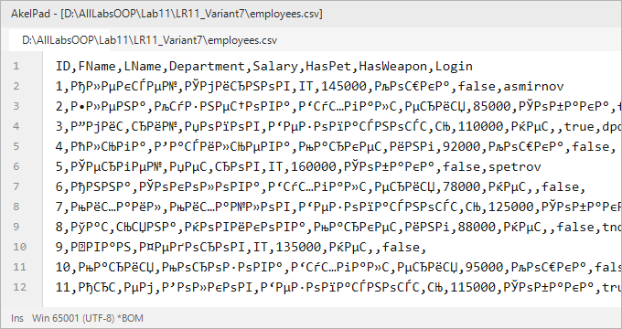
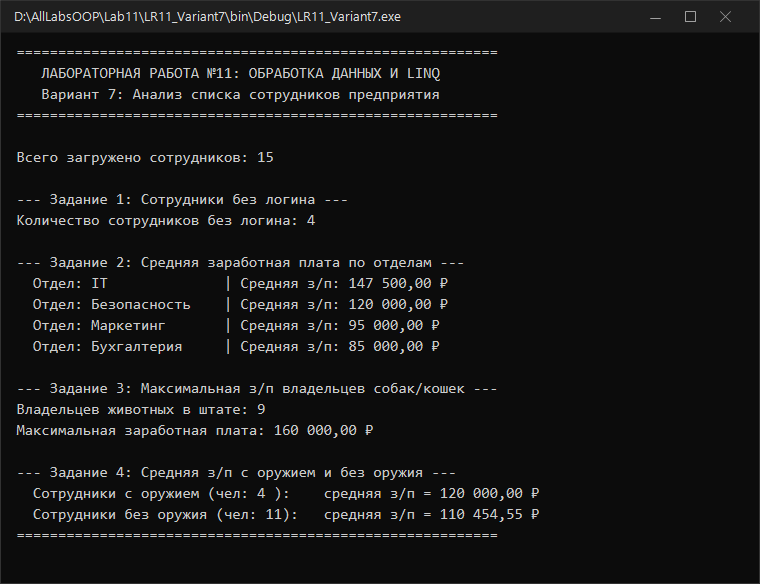
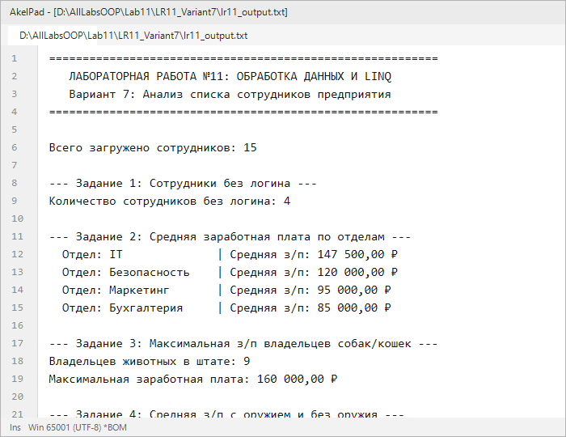

# Северо-Кавказский федеральный университет
**Институт цифрового развития**  
**Кафедра прикладной информатики**

---

### ОТЧЕТ
### по лабораторной работе №11
**по дисциплине: «Объектно-ориентированное программирование»**  
**Тема: «Обработка данных в файлах (CSV и LINQ)»**  
**Вариант №7**

**Выполнил:**  
студент группы ПИН-б-о-24-1  
Мухамеджанов Э. Т.  

Ставрополь, 2026 г.

---

## 1. Цель и задачи работы

**Цель работы:** Научиться выполнять разбор структурированных текстовых файлов формата CSV, моделировать предметную область с помощью классов и выполнять аналитические выборки данных с использованием технологии **LINQ** (Language Integrated Query).

**Задачи работы:**
1. Сформировать файл данных `employees.csv` со структурой: `ID, FName, LName, Department, Salary, HasPet, HasWeapon, Login`.
2. Создать класс `Employee` с фабричным методом парсинга строки `Create()`.
3. Реализовать LINQ-запросы для решения 4 аналитических задач варианта 7.
4. Настроить двойное поведение приложения для сборок Debug (интерактивный консольный вывод) и Release (запись отчета в файл `lr11_output.txt`).

---

## 2. Ход выполнения работы

### 2.1. Индивидуальное задание (Вариант 7)

По представленному набору данных сотрудников требовалось ответить на следующие вопросы:
1. Количество сотрудников без логина;
2. Средняя заработная плата по каждому из 4-х отделов;
3. Максимальная заработная плата сотрудников, у которых есть собака или кошка;
4. Средняя заработная плата у сотрудников с оружием и без оружия.

---

### 2.2. Исходный код программы (`LR11_Variant7/Program.cs`)

```csharp
using System;
using System.Collections.Generic;
using System.IO;
using System.Linq;
using System.Text;

namespace LR11_Variant7
{
    public class Employee
    {
        public int Id { get; set; }
        public string FName { get; set; }
        public string LName { get; set; }
        public string Department { get; set; }
        public double Salary { get; set; }
        public string HasPet { get; set; }
        public bool HasWeapon { get; set; }
        public string Login { get; set; }

        public static Employee Create(string csvLine)
        {
            string[] p = csvLine.Split(',');
            return new Employee
            {
                Id = Convert.ToInt32(p[0].Trim()),
                FName = p[1].Trim(),
                LName = p[2].Trim(),
                Department = p[3].Trim(),
                Salary = Convert.ToDouble(p[4].Trim().Replace('.', ',')),
                HasPet = p[5].Trim(),
                HasWeapon = Convert.ToBoolean(p[6].Trim()),
                Login = p.Length > 7 ? p[7].Trim() : ""
            };
        }
    }

    class Program
    {
        static void Main(string[] args)
        {
            Console.OutputEncoding = Encoding.UTF8;

#if !DEBUG
            TextWriter save_out = Console.Out;
            var new_out = new StreamWriter(@"lr11_output.txt", false, Encoding.UTF8);
            Console.SetOut(new_out);
#endif

            Console.WriteLine("==========================================================");
            Console.WriteLine("   ЛАБОРАТОРНАЯ РАБОТА №11: ОБРАБОТКА ДАННЫХ И LINQ       ");
            Console.WriteLine("   Вариант 7: Анализ списка сотрудников предприятия       ");
            Console.WriteLine("==========================================================\n");

            string filePath = "employees.csv";
            List<Employee> list = new List<Employee>();
            using (StreamReader sr = new StreamReader(filePath, Encoding.UTF8))
            {
                string header = sr.ReadLine();
                string line;
                while ((line = sr.ReadLine()) != null)
                {
                    if (!string.IsNullOrWhiteSpace(line))
                        list.Add(Employee.Create(line));
                }
            }

            Console.WriteLine("Всего загружено сотрудников: {0}\n", list.Count);

            // 1. Количество сотрудников без логина
            int noLoginCount = list.Count(e => string.IsNullOrEmpty(e.Login));
            Console.WriteLine("--- Задание 1: Сотрудники без логина ---");
            Console.WriteLine("Количество сотрудников без логина: {0}\n", noLoginCount);

            // 2. Средняя заработная плата по каждому из 4-х отделов
            Console.WriteLine("--- Задание 2: Средняя заработная плата по отделам ---");
            var deptAverages = list
                .GroupBy(e => e.Department)
                .Select(g => new { Department = g.Key, AvgSalary = g.Average(e => e.Salary) })
                .OrderByDescending(d => d.AvgSalary);

            foreach (var item in deptAverages)
            {
                Console.WriteLine("  Отдел: {0,-15} | Средняя з/п: {1:C2}", item.Department, item.AvgSalary);
            }
            Console.WriteLine();

            // 3. Максимальная з/п сотрудников, у которых есть собака или кошка
            var petEmployees = list.Where(e => e.HasPet == "Собака" || e.HasPet == "Кошка").ToList();
            double maxPetSalary = petEmployees.Any() ? petEmployees.Max(e => e.Salary) : 0;
            Console.WriteLine("--- Задание 3: Максимальная з/п владельцев собак/кошек ---");
            Console.WriteLine("Владельцев животных в штате: {0}", petEmployees.Count);
            Console.WriteLine("Максимальная заработная плата: {0:C2}\n", maxPetSalary);

            // 4. Средняя з/п у сотрудников с оружием и без
            var withWeapon = list.Where(e => e.HasWeapon).ToList();
            var withoutWeapon = list.Where(e => !e.HasWeapon).ToList();

            double avgWithWeapon = withWeapon.Any() ? withWeapon.Average(e => e.Salary) : 0;
            double avgWithoutWeapon = withoutWeapon.Any() ? withoutWeapon.Average(e => e.Salary) : 0;

            Console.WriteLine("--- Задание 4: Средняя з/п с оружием и без оружия ---");
            Console.WriteLine("  Сотрудники с оружием (чел: {0,-2}):    средняя з/п = {1:C2}", withWeapon.Count, avgWithWeapon);
            Console.WriteLine("  Сотрудники без оружия (чел: {0,-2}):   средняя з/п = {1:C2}", withoutWeapon.Count, avgWithoutWeapon);
            Console.WriteLine("==========================================================");

#if !DEBUG
            Console.SetOut(save_out);
            new_out.Close();
#endif
        }
    }
}
```

---

### 2.3. Результаты выполнения

#### Фрагмент исходного файла `employees.csv`:


#### Режим Debug (Консоль):


#### Режим Release (Файл отчета `lr11_output.txt`):


---

## 3. Ответы на контрольные вопросы

**1. Дайте определение понятия «файл».**  
Файл — это именованная область структурированных данных, размещенная на внешнем носителе долговременной памяти, идентифицируемая операционной системой по пути и расширению.

**2. Опишите формат файла *.csv.**  
Формат CSV (Comma-Separated Values) — текстовый табличный формат, где строки отделяются символами перевода строки, а столбцы разделяются разделителями (обычно запятыми `,` или точками с запятой `;`). Первая строка обычно содержит названия полей.

**3. Поясните назначение различных конфигураций (debug или release) при сборке приложения в среде Visual Studio.**  
- Конфигурация `Debug` предназначена для программиста и тестировщика: компилятор не оптимизирует код, сохраняются отладочные символы, активны отладочные трассировки и интерактивные консольные паузы.  
- Конфигурация `Release` предназначена для промышленной эксплуатации: генерируется максимально оптимизированный по скорости код без отладочных накладных расходов.

**4. Приведите пример кода, реализующего различное поведение программы при использовании различных режимов сборки (debug или release).**
```csharp
#if DEBUG
    Console.WriteLine("DEBUG: Подключение к тестовой БД");
#else
    Console.WriteLine("RELEASE: Подключение к продуктивной БД");
#endif
```

**5. Что такое поток? Какие типы классов потоков используются при работе с файлами?**  
Поток — программный объект, представляющий последовательность байтов для чтения или записи. Используются `FileStream` (байтовый доступ), `StreamReader` (построчное декодированное чтение текста) и `StreamWriter` (символьная запись).

**6. Опишите последовательность действий при необходимости записать одну строку в файл. Приведите примеры использования различных классов.**  
- Вариант 1: `File.WriteAllText("log.txt", "Новая строка\n");`  
- Вариант 2:
  ```csharp
  using (StreamWriter sw = new StreamWriter("log.txt", true, Encoding.UTF8)) {
      sw.WriteLine("Новая строка");
  }
  ```

---

## 4. Вывод
В ходе работы был реализован разбор CSV-файлов с динамическим созданием коллекции объектов `Employee` и проведена аналитическая выборка данных с помощью декларативных операторов LINQ (`GroupBy`, `Where`, `Average`, `Max`, `Count`).
