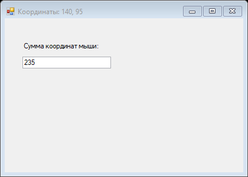
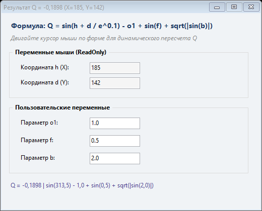

# Северо-Кавказский федеральный университет
**Институт цифрового развития**  
**Кафедра прикладной информатики**

---

### ОТЧЕТ
### по лабораторной работе №12
**по дисциплине: «Объектно-ориентированное программирование»**  
**Тема: «Событийно-ориентированное программирование в графическом интерфейсе Windows Forms»**  
**Вариант №7**

**Выполнил:**  
студент группы ПИН-б-о-24-1  
Мухамеджанов Э. Т.  

Ставрополь, 2026 г.

---

## 1. Цель и задачи работы

**Цель работы:** Изучение архитектуры и принципов событийно-ориентированного программирования, знакомство с созданием приложений с графическим интерфейсом пользователя (GUI) на платформе .NET Windows Forms, разработка обработчиков событий мыши и элементов управления.

**Задачи работы:**
1. Разработать и протестировать учебное демонстрационное приложение (`LR12_Demo`), перехватывающее событие движения указателя мыши `MouseMove`, выводящее координаты в заголовок формы и их сумму — в текстовое поле `TextBox`.
2. Разработать приложение для индивидуального варианта №7 (`LR12_Variant7`), выполняющее расчет математического выражения:
   $$Q = \sin\left(h + \frac{d}{e^{0.1}}\right) - o_1 + \sin(f) + \sqrt{|\sin(b)|}$$
3. Связать переменные $h$ и $d$ с координатами курсора мыши над областью формы с блокировкой соответствующих текстовых полей от ручного редактирования (`ReadOnly = true`).
4. Обеспечить ввод параметров $o_1, f, b$ пользователем через текстовые поля с мгновенным динамическим пересчетом функции по событию `TextChanged`.
5. Реализовать отображение результата в заголовке формы с корректной обработкой исключительных ситуаций и выводом сообщения `ERROR` в случае некорректных данных или деления на ноль.

---

## 2. Ход выполнения работы

### 2.1. Учебная задача (Демо)

В соответствии с методическими указаниями было реализовано приложение `LR12_Demo`, в котором создана форма с текстовым полем. Обработчик `MouseMove` динамически считывает координаты $X$ и $Y$ мыши из аргумента `MouseEventArgs e`, обновляет заголовок окна и заносит сумму координат в `textBox1`.

#### Исходный код демонстрационного проекта (`Lab12/LR12_Demo/Program.cs`):
```csharp
using System;
using System.Drawing;
using System.Windows.Forms;

namespace LR12_Demo
{
    public class Form1 : Form
    {
        private TextBox textBox1;

        public Form1()
        {
            this.Text = "Лабораторная работа №12 (Demo)";
            this.Size = new Size(420, 300);
            this.StartPosition = FormStartPosition.CenterScreen;

            Label lbl = new Label { 
                Text = "Сумма координат мыши:", 
                Location = new Point(30, 40), 
                Size = new Size(180, 20) 
            };
            textBox1 = new TextBox { 
                Location = new Point(30, 65), 
                Size = new Size(150, 25) 
            };

            this.Controls.Add(lbl);
            this.Controls.Add(textBox1);

            this.MouseMove += new MouseEventHandler(Form1_MouseMove);
        }

        public void Form1_MouseMove(object sender, MouseEventArgs e)
        {
            Text = string.Format("Координаты: {0}, {1}", e.X, e.Y);
            textBox1.Text = (e.X + e.Y).ToString();
        }

        public void SetCoords(int x, int y)
        {
            Text = string.Format("Координаты: {0}, {1}", x, y);
            textBox1.Text = (x + y).ToString();
        }
    }

    class Program
    {
        [STAThread]
        static void Main(string[] args)
        {
            Application.EnableVisualStyles();
            Application.SetCompatibleTextRenderingDefault(false);
            Application.Run(new Form1());
        }
    }
}
```


*Рисунок 12.1 — Работа демонстрационного приложения Windows Forms*

---

### 2.2. Индивидуальное задание (Вариант 7)

#### Математическая модель
Требуется вычислять значение функции:
$$Q = \sin\left(h + \frac{d}{e^{0.1}}\right) - o_1 + \sin(f) + \sqrt{|\sin(b)|}$$
где:
- $h$ — координата $X$ курсора мыши;
- $d$ — координата $Y$ курсора мыши;
- $e^{0.1} = \exp(0.1) \approx 1.1051709$;
- $o_1, f, b$ — числовые параметры, задаваемые пользователем.

#### Особенности реализации интерфейса:
1. Созданы две логические группы элементов `GroupBox`:
   - «Переменные мыши (ReadOnly)» для полей $h$ и $d$;
   - «Пользовательские переменные» для параметров $o_1$, $f$ и $b$.
2. Текстовые поля координат $h$ и $d$ переведены в режим `ReadOnly = true` со светло-серым фоном.
3. Обработчик `MouseMove` подключен как к самой форме, так и к дочерним контейнерам, с вычислением относительных координат методом `PointToClient()`.
4. Для обеспечения мгновенной отзывчивости интерфейса к событиям `TextChanged` параметров $o_1, f, b$ привязана функция `Recalculate()`.
5. Результат вычисления $Q$ форматируется до 4 знаков после запятой и отображается в свойстве `this.Text` (заголовке окна). В случае синтаксических ошибок парсинга чисел или математической неопределенности в заголовок выводится `ERROR`.

#### Исходный код (`Lab12/LR12_Variant7/Program.cs`):
```csharp
using System;
using System.Drawing;
using System.Windows.Forms;

namespace LR12_Variant7
{
    public class MainForm : Form
    {
        private TextBox txtH;
        private TextBox txtD;
        private TextBox txtO1;
        private TextBox txtF;
        private TextBox txtB;
        private Label lblStatus;

        public MainForm()
        {
            InitializeComponents();
        }

        private void InitializeComponents()
        {
            this.Text = "Лабораторная работа №12 (Вариант 7)";
            this.Size = new Size(520, 420);
            this.StartPosition = FormStartPosition.CenterScreen;
            this.FormBorderStyle = FormBorderStyle.FixedDialog;
            this.MaximizeBox = false;
            this.BackColor = Color.FromArgb(240, 243, 246);

            // Заголовок формы
            Label lblHeader = new Label();
            lblHeader.Text = "Формула: Q = sin(h + d / e^0.1) - o1 + sin(f) + sqrt(|sin(b)|)";
            lblHeader.Font = new Font("Segoe UI", 10, FontStyle.Bold);
            lblHeader.ForeColor = Color.FromArgb(30, 60, 100);
            lblHeader.Location = new Point(15, 15);
            lblHeader.Size = new Size(480, 25);
            this.Controls.Add(lblHeader);

            // Подсказка
            Label lblHint = new Label();
            lblHint.Text = "Двигайте курсор мыши по форме для динамического пересчета Q";
            lblHint.Font = new Font("Segoe UI", 8.5f, FontStyle.Italic);
            lblHint.ForeColor = Color.Gray;
            lblHint.Location = new Point(15, 42);
            lblHint.Size = new Size(480, 20);
            this.Controls.Add(lblHint);

            // Группа переменных мыши
            GroupBox grpMouse = new GroupBox();
            grpMouse.Text = " Переменные мыши (ReadOnly) ";
            grpMouse.Font = new Font("Segoe UI", 9, FontStyle.Bold);
            grpMouse.Location = new Point(15, 70);
            grpMouse.Size = new Size(475, 100);
            this.Controls.Add(grpMouse);

            Label lblH = new Label { Text = "Координата h (X):", Location = new Point(20, 30), Size = new Size(130, 22), Font = new Font("Segoe UI", 9) };
            txtH = new TextBox { Location = new Point(160, 28), Size = new Size(100, 22), ReadOnly = true, BackColor = Color.WhiteSmoke, Font = new Font("Segoe UI", 9) };
            Label lblD = new Label { Text = "Координата d (Y):", Location = new Point(20, 60), Size = new Size(130, 22), Font = new Font("Segoe UI", 9) };
            txtD = new TextBox { Location = new Point(160, 58), Size = new Size(100, 22), ReadOnly = true, BackColor = Color.WhiteSmoke, Font = new Font("Segoe UI", 9) };

            grpMouse.Controls.Add(lblH);
            grpMouse.Controls.Add(txtH);
            grpMouse.Controls.Add(lblD);
            grpMouse.Controls.Add(txtD);

            // Группа пользовательских переменных
            GroupBox grpUser = new GroupBox();
            grpUser.Text = " Пользовательские переменные ";
            grpUser.Font = new Font("Segoe UI", 9, FontStyle.Bold);
            grpUser.Location = new Point(15, 180);
            grpUser.Size = new Size(475, 140);
            this.Controls.Add(grpUser);

            Label lblO1 = new Label { Text = "Параметр o1:", Location = new Point(20, 30), Size = new Size(130, 22), Font = new Font("Segoe UI", 9) };
            txtO1 = new TextBox { Text = "1.0", Location = new Point(160, 28), Size = new Size(100, 22), Font = new Font("Segoe UI", 9) };
            Label lblF = new Label { Text = "Параметр f:", Location = new Point(20, 65), Size = new Size(130, 22), Font = new Font("Segoe UI", 9) };
            txtF = new TextBox { Text = "0.5", Location = new Point(160, 63), Size = new Size(100, 22), Font = new Font("Segoe UI", 9) };
            Label lblB = new Label { Text = "Параметр b:", Location = new Point(20, 100), Size = new Size(130, 22), Font = new Font("Segoe UI", 9) };
            txtB = new TextBox { Text = "2.0", Location = new Point(160, 98), Size = new Size(100, 22), Font = new Font("Segoe UI", 9) };

            grpUser.Controls.Add(lblO1);
            grpUser.Controls.Add(txtO1);
            grpUser.Controls.Add(lblF);
            grpUser.Controls.Add(txtF);
            grpUser.Controls.Add(lblB);
            grpUser.Controls.Add(txtB);

            // Информационный статус
            lblStatus = new Label();
            lblStatus.Text = "Текущий результат выводится в заголовок окна";
            lblStatus.Font = new Font("Segoe UI", 9);
            lblStatus.ForeColor = Color.DarkSlateBlue;
            lblStatus.Location = new Point(15, 335);
            lblStatus.Size = new Size(475, 25);
            this.Controls.Add(lblStatus);

            // Подписка на события мыши
            this.MouseMove += new MouseEventHandler(MainForm_MouseMove);
            grpMouse.MouseMove += new MouseEventHandler(SubControl_MouseMove);
            grpUser.MouseMove += new MouseEventHandler(SubControl_MouseMove);

            // Подписка на изменение текста параметров
            txtO1.TextChanged += (s, e) => Recalculate();
            txtF.TextChanged += (s, e) => Recalculate();
            txtB.TextChanged += (s, e) => Recalculate();

            // Первичный расчет
            UpdateCoordinates(185, 142);
        }

        private void SubControl_MouseMove(object sender, MouseEventArgs e)
        {
            Control c = sender as Control;
            Point p = this.PointToClient(c.PointToScreen(e.Location));
            UpdateCoordinates(p.X, p.Y);
        }

        private void MainForm_MouseMove(object sender, MouseEventArgs e)
        {
            UpdateCoordinates(e.X, e.Y);
        }

        public void UpdateCoordinates(int x, int y)
        {
            txtH.Text = x.ToString();
            txtD.Text = y.ToString();
            Recalculate();
        }

        private void Recalculate()
        {
            try
            {
                double h = Convert.ToDouble(txtH.Text);
                double d = Convert.ToDouble(txtD.Text);
                double o1 = Convert.ToDouble(txtO1.Text.Replace('.', ','));
                double f = Convert.ToDouble(txtF.Text.Replace('.', ','));
                double b = Convert.ToDouble(txtB.Text.Replace('.', ','));

                // Q = sin(h + d / e^0.1) - o1 + sin(f) + sqrt(|sin(b)|)
                double expFactor = Math.Exp(0.1);
                double inner = h + (d / expFactor);
                double term1 = Math.Sin(inner);
                double term2 = o1;
                double term3 = Math.Sin(f);
                double term4 = Math.Sqrt(Math.Abs(Math.Sin(b)));

                double Q = term1 - term2 + term3 + term4;

                if (double.IsNaN(Q) || double.IsInfinity(Q))
                {
                    this.Text = "Результат Q = ERROR";
                    lblStatus.Text = "Статус: Выражение не определено (ERROR)";
                }
                else
                {
                    this.Text = string.Format("Результат Q = {0:0.0000} (X={1}, Y={2})", Q, h, d);
                    lblStatus.Text = string.Format("Q = {0:0.0000} | sin({1:0.0}) - {2:0.0} + sin({3:0.0}) + sqrt(|sin({4:0.0})|)",
                        Q, inner, o1, f, b);
                }
            }
            catch
            {
                this.Text = "Результат Q = ERROR";
                lblStatus.Text = "Статус: Ошибка ввода параметров (ERROR)";
            }
        }
    }

    class Program
    {
        [STAThread]
        static void Main(string[] args)
        {
            Application.EnableVisualStyles();
            Application.SetCompatibleTextRenderingDefault(false);
            Application.Run(new MainForm());
        }
    }
}
```


*Рисунок 12.2 — Внешний вид оконного приложения Варианта 7 в процессе динамического расчета*

---

## 3. Ответы на контрольные вопросы

### 1. Какие файлы описывают класс формы?
В среде Microsoft Visual Studio при разработке приложений Windows Forms класс оконной формы обычно разделяется с помощью ключевого слова `partial` на следующие файлы:
1. `Form1.cs` — основной файл с исходным кодом класса формы, содержащий пользовательскую бизнес-логику, конструктор и методы-обработчики событий;
2. `Form1.Designer.cs` — вспомогательный файл, автоматически генерируемый визуальным дизайнером Visual Studio. В нем расположен метод `InitializeComponent()`, содержащий код инициализации компонентов, установки их свойств (размеры, координаты, цвета) и подписки на события;
3. `Form1.resx` — XML-файл ресурсов формы, хранящий локализованные строки, растровые изображения, иконки и прочие бинарные данные, используемые формой.

### 2. Какие действия необходимо выполнить для создания обработчика события?
Для создания обработчика события можно использовать два подхода:
- **В визуальном дизайнере (GUI):**
  1. Выделить нужный элемент управления (или саму форму) в окне визуального конструктора.
  2. В окне «Свойства» (*Properties*) нажать кнопку со значком молнии (*Events*).
  3. Найти интересующее событие (например, `Click` или `MouseMove`) и дважды кликнуть по текстовому полю рядом с ним. Среда разработки автоматически сгенерирует заготовку метода-обработчика в `Form1.cs` и добавит код привязки в `Form1.Designer.cs`.
- **Программно в коде:**
  1. Объявить в классе формы метод с сигнатурой, соответствующей типу делегата события (например, `private void MyHandler(object sender, MouseEventArgs e)`).
  2. Подписать метод на событие с помощью оператора `+=`:
     ```csharp
     this.MouseMove += new MouseEventHandler(MyHandler);
     // или используя лямбда-выражение:
     this.MouseMove += (sender, e) => { /* логика */ };
     ```

### 3. Где описывается код обработчика события? В каком файле регистрируется обработчик события (метод привязывается к событию)?
- **Код обработчика события** (алгоритм обработки) описывается непосредственно в файле `Form1.cs` в виде метода класса формы.
- **Регистрация обработчика события** (привязка метода к событию через оператор `+=`) при использовании визуального дизайнера Visual Studio генерируется в файле `Form1.Designer.cs` внутри метода `InitializeComponent()`. Если приложение пишется вручную без использования визуального дизайнера, то привязка производится непосредственно в конструкторе формы или в собственном методе инициализации в `Form1.cs`.

### 4. Как получить доступ к координатам курсора мыши?
Координаты курсора мыши можно получить следующими способами:
1. **Через аргумент события мыши `MouseEventArgs e`:** В любом методе-обработчике событий мыши (`MouseMove`, `MouseDown`, `MouseUp`) объект `e` предоставляет свойства `e.X` и `e.Y`, возвращающие координаты указателя мыши в пикселях относительно левого верхнего угла клиентской области того элемента, над которым произошло событие.
2. **Через глобальный статический класс `System.Windows.Forms.Cursor`:** Свойство `Cursor.Position` возвращает абсолютные экранные координаты курсора `System.Drawing.Point(X, Y)`. Для преобразования глобальных экранных координат в координаты относительно текущей формы используется метод `this.PointToClient(Cursor.Position)`.

### 5. Какой класс содержит методы, реализующие математические функции?
Все базовые математические функции в платформе .NET реализованы в статическом классе `System.Math` (пространство имен `System`).  
Класс `Math` включает:
- Тригонометрические функции: `Math.Sin()`, `Math.Cos()`, `Math.Tan()`, `Math.Asin()`, `Math.Acos()`, `Math.Atan()`;
- Показательные и логарифмические функции: `Math.Exp()`, `Math.Log()`, `Math.Log10()`, `Math.Pow()`;
- Вспомогательные функции: `Math.Sqrt()`, `Math.Abs()`, `Math.Min()`, `Math.Max()`, `Math.Round()`, `Math.Truncate()`;
- Математические константы: `Math.PI` ($\pi \approx 3.1415926535$) и `Math.E` ($e \approx 2.7182818284$).

---

## 4. Заключение

В ходе выполнения лабораторной работы были освоены основы разработки интерактивных графических приложений на платформе Windows Forms с использованием событийно-ориентированной модели. Успешно реализованы механизмы отслеживания перемещения курсора мыши `MouseMove`, обновление данных в реальном времени, валидация пользовательского ввода и обработка исключений при вычислении сложного математического выражения в соответствии с вариантом №7.
